# September 28: Getting oriented and gathering design references

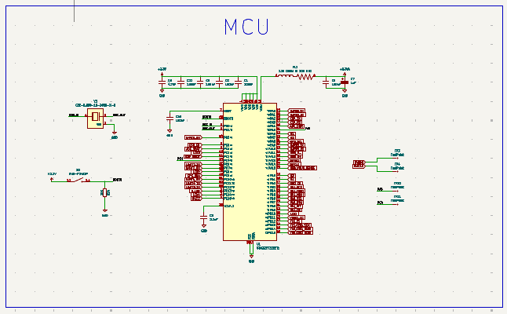

I started by getting clear on the board I wanted to make: a compact STM32F722 flight controller with an IMU, barometer, storage, USB-C, regulators, and the extra ESP32-C3 block. I gathered the project’s part symbols, footprints, and 3D models and checked the MCU section so I had a real pinout to work from. Research itself wasn’t hours of reading datasheets cover to cover; the time estimate includes finding and sorting the design files too.

My main goal was to avoid picking parts as a vibe and then discovering they couldn’t connect sensibly. I made a short list of the interfaces I’d need to account for. Lowkey, that list got big fast.

**Total time spent: 1 hour 20 minutes**

# September 29: Drawing the MCU section

I laid out the STM32F722RETx block in KiCad, arranging power, reset, clock, and BOOT0 connections before grouping the signal labels around the chip. I checked pin numbers while adding the SPI, UART, USB, and motor nets so the page would be readable and the intended connections were visible.

The annoying part was keeping the labels legible around a dense symbol. I moved them around a few times and checked the pin assignments again instead of trusting the first placement. This is a drawn MCU circuit, not a programmed or powered MCU, and I’m keeping that distinction clear.

**Total time spent: 2 hours 30 minutes**

# September 30: Organizing connectors and signals

I worked through the connector side of the design and checked the labels for the external connections. I compared the JST connector section with the board’s front and back component views to get a sense of whether the schematic organization would make the physical connections understandable.

There are a lot of named signals in a flight controller, and a connector can look totally fine while still being easy to misread. I’m not calling every assignment verified yet; this pass was about making the design easier to follow before layout and later pin-map review.

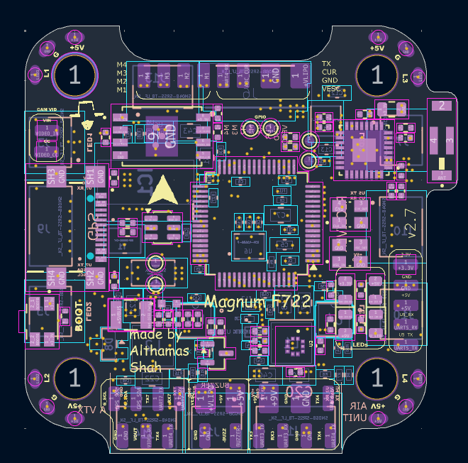
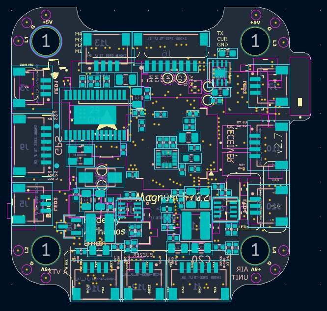

**Total time spent: 1 hour 30 minutes**

# October 1: Drawing the IMU circuit

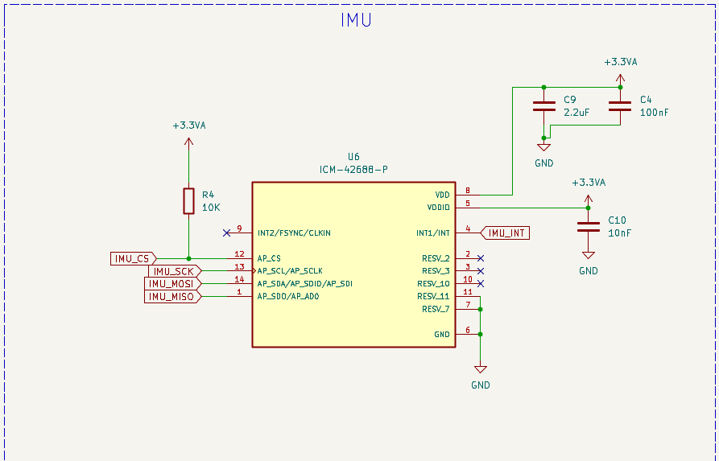

I worked on the ICM-42688-P section: supply, decoupling, SPI signals, chip select, and the interrupt connection. I traced the named nets back toward the STM32 and checked the symbol pins rather than assuming similar-looking signal names were interchangeable.

The IMU is one of the parts I care about most on this board, so I slowed down here. The schematic tells me what I intend to connect; it cannot tell me the gyro’s real orientation on a finished board or whether it communicates. That part is still ahead. Tiny bit frustrating, but pretending otherwise would be worse.

**Total time spent: 2 hours 20 minutes**

# October 2: Adding the barometer

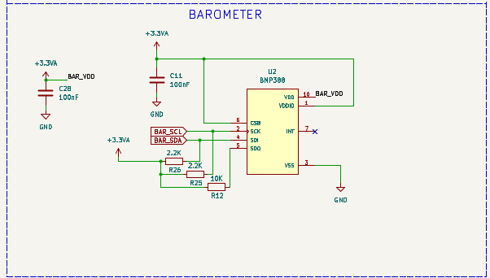

I added and reviewed the BMP388 block, following its I²C labels toward the MCU and checking the local supply and capacitor connections. Compared with the MCU page, this circuit is smaller, but I still checked that the signal labels landed on the nets I meant them to.

I also kept the sensor’s eventual placement in mind. A barometer has to sense pressure, so its location and exposure matter; the screenshot only shows the schematic side of that decision. No altitude readings exist yet.

**Total time spent: 1 hour 45 minutes**

# October 3: Adding the onboard flash circuit

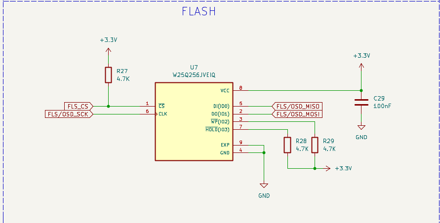

I worked on the onboard flash connection and its SPI and chip-select signals. The intended use is flight-log storage. I checked the flash symbol and its net labels against the MCU connections so the circuit was represented consistently.

I did not catch the ordering-part mismatch in this pass: the BOM names `W25Q256JVEIQ`, while the schematic and PCB identify `W25N04KVZEIR`. That is a real unresolved issue, not a tiny typo I can safely ignore. The part and firmware support need a deliberate decision before ordering or enabling flash.

**Total time spent: 2 hours**

# October 4: Drawing the 9 V regulator

I worked through the 9 V power block around the MP9943GQ-Z, following the input, switching components, feedback, and output nets shown in the schematic. I also checked the rail labels and surrounding capacitors so the section reads like a complete circuit rather than just a regulator symbol dropped onto a page.

The schematic labels this as a 9 V rail with a stated current rating. That rating is a design claim to validate, not a measured result. I still need calculations and a safe load test on actual hardware before saying how it behaves. Power sections deserve a little extra respect; they can get spicy in a very non-fun way.

**Total time spent: 2 hours 20 minutes**

# October 5: Drawing the 5 V regulator

I reviewed the separate 5 V regulator section, also based on an MP9943GQ-Z. I followed its feedback and output path and checked that it remained separate from the 9 V rail. The two blocks look similar, which makes it extra easy to mentally copy a connection and miss a difference.

This pass moved quicker because I knew what to inspect from the previous power section. Still, the current rating is only what the design intends; it needs thermal and load validation on the built board.

**Total time spent: 2 hours 10 minutes**

# October 6: Checking the 3.3 V rails

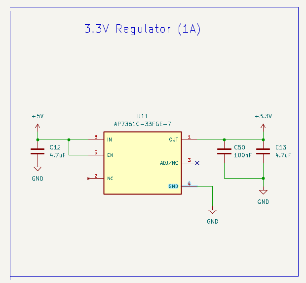

I reviewed the digital and analog 3.3 V sections together. The design uses an AP7361C for one rail and an NCP167-family part for the analog side. I followed the supply nets and looked over the filtering and decoupling around both sections.

Keeping the rails separate looks intentional on the schematic, but quiet analog power is something I need to measure, not just declare because the labels say “analog.” This is where the design starts to feel like a bunch of small decisions that all affect the same tiny board. Lowkey a lot to keep straight.

**Total time spent: 2 hours 15 minutes**

# October 7: Checking USB-C and battery sensing

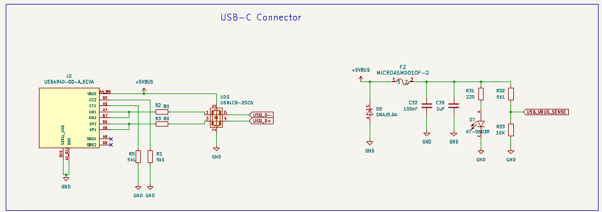
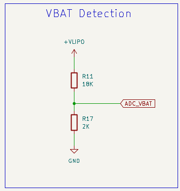

I reviewed the USB-C connection, including the data lines, CC resistors, and protection shown in the schematic. I also checked the battery-voltage sensing section and followed its signal toward the MCU. Both sections need to make sense electrically and be easy to identify later when firmware is configured.

Connector orientation and divider scaling are the kind of details that can look settled in CAD but still need a careful final check. The design files show the circuits; they don’t show a successful USB connection or calibrated battery reading yet.

**Total time spent: 2 hours 10 minutes**

# October 8: Adding the ESP32-C3 section

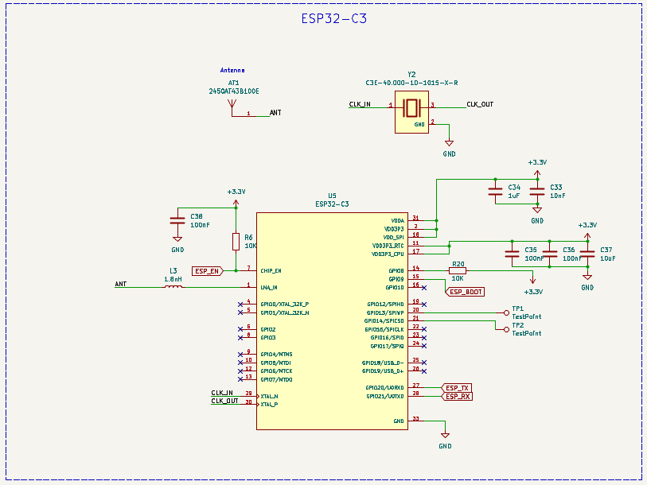

I worked on the ESP32-C3 block and its serial, enable, boot, and antenna-related connections. I checked how the signals tie back into the overall design and made sure the section was represented as a coprocessor idea, not as already-working wireless firmware.

This adds flexibility, but it also adds another chip and another firmware story to figure out. The repository has the hardware design, not a wireless implementation or range test. I’m keeping that boundary clear even though it would be pretty cool to see it working.

**Total time spent: 2 hours 15 minutes**

# October 9: Reviewing OSD, buzzer, and status LEDs

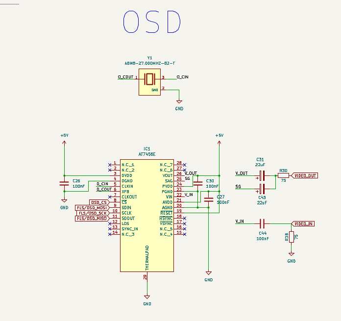
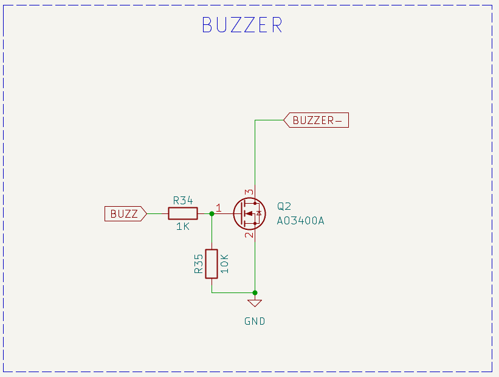

I reviewed the AT7456E OSD section, buzzer, and status LEDs. The OSD circuitry is analog, so I checked that wording in the project docs too. I wanted the small support blocks visible alongside the MCU and sensor work, since these are easy to overlook until there’s suddenly no usable status indicator or OSD connection.

I’m not claiming any of these outputs have been tested. They’re present in the design, and still need continuity checks, firmware support, and bench verification on actual hardware.

**Total time spent: 2 hours**

# October 10: Fitting the design into the board outline

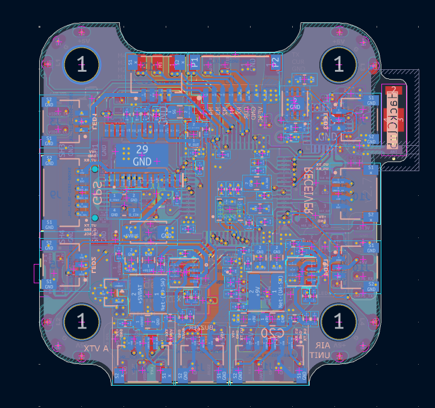

I moved into the PCB layout and worked on fitting the parts inside the 30 × 30 mm outline. Mounting holes and connectors set hard boundaries, while the MCU, sensors, regulators, and antenna all compete for room. I tried to place related circuits sensibly so routing would have a chance later.

This was my “wait, this is actually tiny” moment. I stopped trying to make every part look perfectly symmetrical and focused on keeping useful groups together. The board file has six copper layers, which gives more routing options, but does not magically make placement easy.

**Total time spent: 2 hours 30 minutes**

# October 11: Routing around the MCU

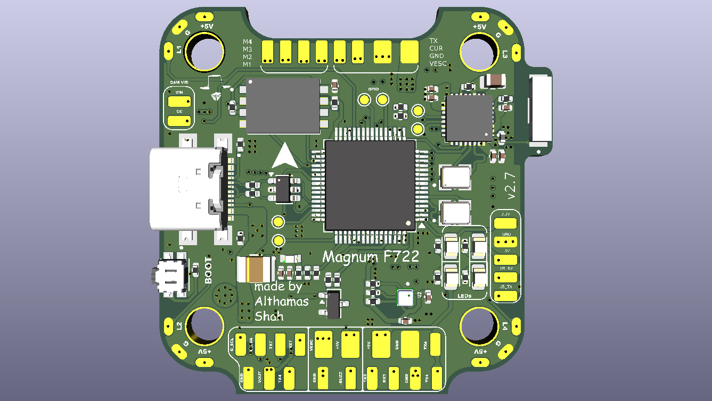

I started routing through the dense MCU area and out toward the other blocks. I checked net names as I worked and used vias where a route needed to continue on another copper layer. The amount of connections in that area made it hard to see the whole picture at once, so I focused on one cluster at a time.

The render helps me orient myself, but it isn’t evidence that every net is routed correctly or that design-rule checks pass. This was a routing pass, not a final sign-off. I’m trying to keep the confidence level honest.

**Total time spent: 2 hours 40 minutes**

# October 12: Routing the sensor and power areas

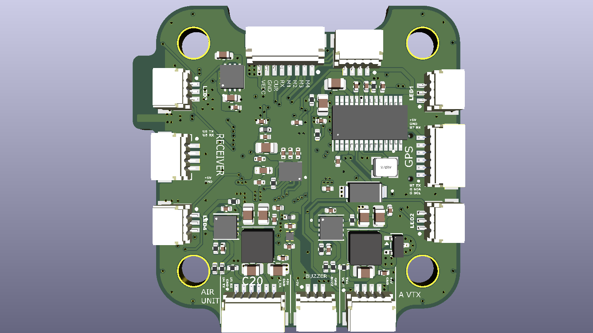

I continued routing between the sensor, power, and MCU sections, switching between the schematic and board to check net names and layer transitions. I paid attention to the IMU’s neighborhood while routing around the switching regulators, but I can’t claim low noise from a layout screenshot alone.

I also looked at the back-side silkscreen view to see whether the labels were legible and oriented in a way that would help assembly. Having a separate pass for routing and readability made the work feel less like an endless ratsnest. Still a lot to verify, though.

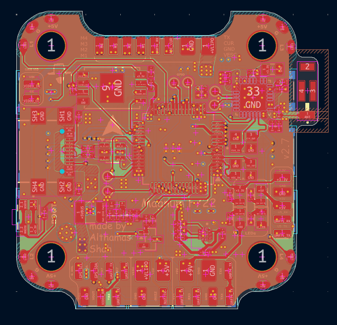

**Total time spent: 2 hours 35 minutes**

# October 13: Routing cleanup and connector review

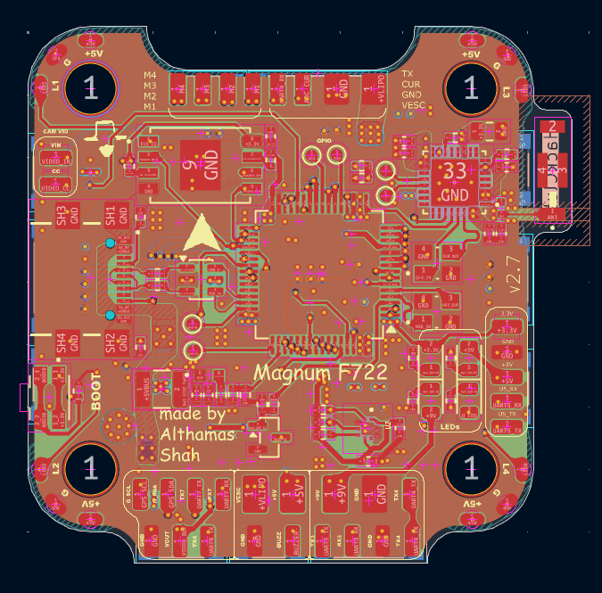

I reviewed the front silkscreen and the external LED connections while cleaning up the board view. I looked for labels that might be hard to read and checked that the LED header was represented as part of the design, not as a feature I’d already tested.

The project includes fabrication exports, but I don’t have a final DRC report or a verified manufacturing acceptance result in these files. So I’m treating this as a visual and connectivity review pass, with formal checks still on the list.

**Total time spent: 2 hours 25 minutes**

# October 14: Comparing the BOM and saved cart

I compared the component list with the saved cart view and checked the U7 flash part against the schematic and PCB. The BOM says `W25Q256JVEIQ`; the design files say `W25N04KVZEIR`. Those are different devices, so I stopped short of treating the cart as an order list.

It’s frustrating to find a mismatch after other design work, but much better here than after a package arrives. The part needs to be resolved, the BOM regenerated, and the updated cart checked before anyone buys components. These screenshots show saved cart contents, not a completed purchase.

**Total time spent: 2 hours**

# October 15: Reviewing the manufacturing views

I checked the component placement views against the exported production files: BOM, positions, designators, IPC netlist, and the fabrication archive. I looked for orientation and labeling issues that could make assembly confusing.

These files are useful handoff material, but their presence doesn’t mean the package passed a factory’s checks. The flash mismatch remains a blocker, so the exports need to be regenerated after that decision and then checked against the final board revision. Mildly annoying, very necessary.

**Total time spent: 1 hour 50 minutes**

# October 16: Looking over the power and connector details

I did a focused pass over the power blocks and connector sections again, following the labels between the design sheets and the board. I was looking for anything that would make the supply and external connections hard to understand before manufacturing.

This is a review of the CAD files, not a claim that the rails were measured or the connectors tested. I kept the remaining checks visible because “looks connected” isn’t the same as “safe to power.”

**Total time spent: 2 hours**

# October 18: Final file and feature consistency check

I cross-checked the feature descriptions against the schematic and board files, including the barometer, IMU, and flash. I made sure the docs describe the AT7456E as analog OSD and say plainly that the board is still at the design stage.

The main open items are still real: resolve U7, verify pin assignments and the motor timer map, check the questionable UART direction, run final design and manufacturing checks, and then build and bench-test the board. It’s not the satisfying “everything is done” ending, but it’s honest—and honestly, that’s more useful than hype.

**Total time spent: 2 hours**

# October 18: Drafting the Betaflight target and closing the journal

I pulled the known pin assignments into an early Betaflight target draft under `firmware/configs/CUST/MAGNUMFC/config.h` and wrote down the blockers in `firmware/README.md`. I left motor outputs and onboard flash disabled rather than inventing a timer map or pretending the BOM mismatch was resolved.

The target is not built or tested, and the board has not flown. That’s a little anticlimactic for a flight-controller project, but firmware can’t rescue an unverified pin map. The next meaningful step is to resolve the design issues, build the board, and validate it safely on the bench.

**Total time spent: 2 hours 25 minutes**
