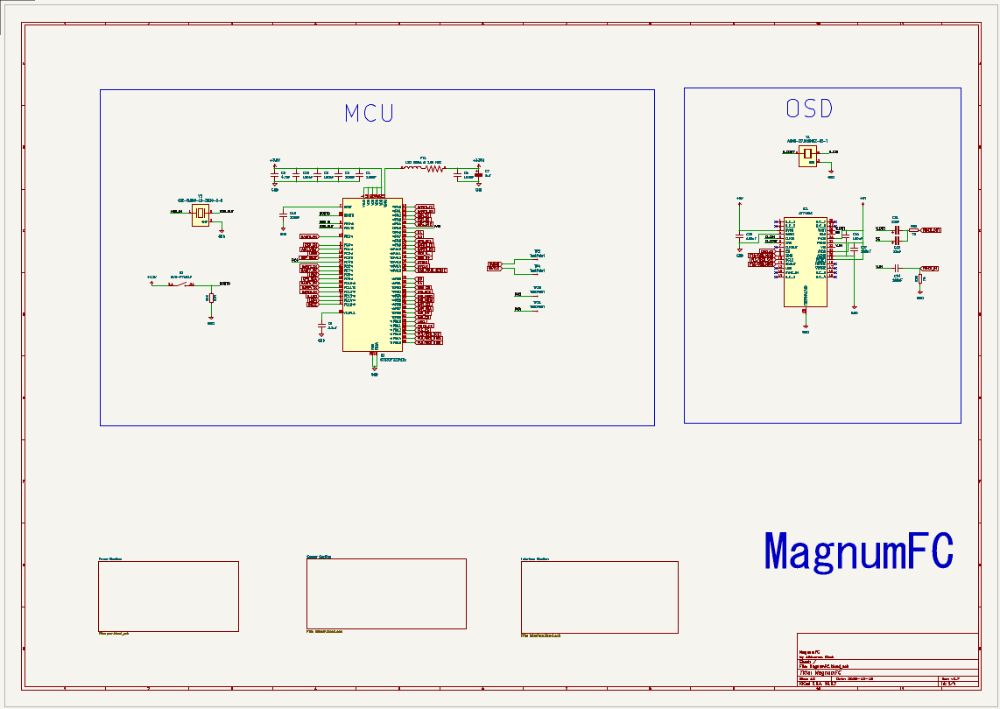

# MagnumFC

MagnumFC is my 30 × 30 mm flight-controller design, built in KiCad around an STM32F722RETx. Honestly? This project has been such a fun rabbit hole. I wanted to build a compact FPV controller that felt useful, clean, and a bit more intentional than a random stack of boards shoved together with duct-tape energy.

The idea is simple but kinda cool: keep the board small, give the IMU and power rails proper attention, and make a design that actually looks like it could become something real. Lowkey, I’m hyped about it because this is the kind of hardware project that turns into a whole obsession once the schematic starts to come together.

## Why I built this

I wanted a flight-controller board that felt compact without becoming a mess of routing and half-documented shortcuts. The plan was to include the essentials:

- STM32F722 main controller
- ICM-42688-P IMU
- BMP388 barometer
- ESP32-C3 coprocessor
- USB-C connection
- analog OSD support
- separate 5 V and 9 V supply rails

It’s the kind of project that feels slightly chaotic in the best way. You start with a few part choices, a rough concept, and then suddenly you’re deep in power rails, pin assignments, and the weird little details that decide whether a board is actually usable or just a pretty render.

## Design overview

| Component or section | Intended role |
| --- | --- |
| STM32F722RETx | Main flight-controller MCU |
| ICM-42688-P | SPI gyroscope and accelerometer |
| BMP388 | Barometer |
| ESP32-C3 | Wireless-connectivity coprocessor |
| W25N04KVZEIR | NAND flash shown in the schematic and PCB; confirm device support before enabling it in firmware |
| MP9943GQ-Z × 2 | Switching 9 V and 5 V rails |
| AP7361C and NCP167 | Separate digital and analog 3.3 V rails, as represented in the design |
| AT7456E | Analog OSD circuitry |
| USB-C | USB connection to the flight controller |

## Board renders

These images are KiCad renders and design screenshots, not photos of a manufactured board. So yes, they look sick, but they’re still just the design phase, not a fully proven hardware build.

More circuit and layout screenshots are in [`Screenshots/`](Screenshots/). The schematic is also available as [`docs/sch.pdf`](docs/sch.pdf).

## Firmware note

The files under [`firmware/`](firmware/) are an early Betaflight target configuration draft, not a compiled firmware image. That part is intentionally unfinished. I left motor output and onboard flash configuration unresolved instead of pretending everything is fine when it’s not.

## Repo structure

- [`PCB/`](PCB/) — KiCad schematic, PCB layout, custom libraries, and manufacturing exports
- [`production/`](production/) — BOM, placement, designators, netlist, and fabrication package
- [`firmware/`](firmware/) — early Betaflight target draft and validation notes
- [`Screenshots/`](Screenshots/) — design and layout images
- [`docs/`](docs/) — schematic PDF
- [`JOURNAL.md`](JOURNAL.md) — work journal and design notes

## LICENSE

MIT

### Happy forging!
